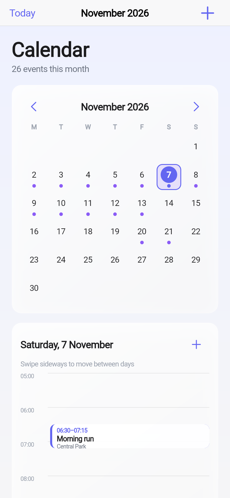

# Vector Calendar

**How is today going — and what is actually startable right now?**

Part of the **VECTOR Suite** — three apps, one private database.

---

## What It Shows

The unit of work is **today**, and the screen answers three questions in order:

1. **What can I start?** Only tasks whose blockers are finished. A blocked task is never shown, so the list is never a wall of things you cannot do yet.
2. **How much is planned?** Total minutes of startable work.
3. **What did I actually do?** Tasks completed today, plus minutes of tracked focus.

A month grid shows you everything you are behind on. This shows you the next thing, and what you already got done.

## Home‑Screen Widget

`TodayWidget` (Android) shows the next task, how many are startable, planned minutes, and completed count — without opening the app.

## Screens

| Screen | Description |
|--------|-------------|
| **Today** | Three stats (to start / minutes planned / focused), then the startable list, then what is done. |
| **Pull to refresh** | Native Cupertino refresh. |

## Why "Startable" Is Computed Server‑Side

The blocking rule lives in the database view, not in this app:

```sql
where t.status in ('todo','doing')
  and (t.blocked_by is null or b.status = 'done')
```

If each app filtered independently, they could disagree — and the user would see work on the calendar that the tasks app says is not ready. One definition, one source of truth.

<!-- SCREENSHOTS-AUTO:BEGIN -->
## Screenshots

Captured by CI (`.github/workflows/screenshots.yml`) with Playwright against a
local stub API (`scripts/stub_api.py`) serving realistic November 2026 data.
Viewport: 390×844, device scale 2×, CanvasKit renderer, Liquid Glass UI.

| Screen | Description |
|--------|-------------|
|  | Month grid — November 2026, busy-day dots, today ring, selected day |
|  | Day agenda — hour grid (05:00–24:00), timed event blocks, all-day strip |
|  | Undated inbox — work without a scheduled time |
|  | Full page — month grid, day agenda, and inbox in one view |
<!-- SCREENSHOTS-AUTO:END -->

## Architecture

```
Flutter app  ──HTTP──▶  VECTOR Suite API  ──▶  private database
  (this repo)             (today + store)
```

## Build

```bash
flutter pub get
flutter test
flutter build apk --release --target-platform android-arm64 --split-per-abi
```

```bash
flutter build apk --dart-define=API_BASE=https://your-host
```

CI injects `API_BASE` from the repository variable of the same name, so the endpoint can change without touching code.

## The VECTOR Suite

| App | Question it answers |
|-----|---------------------|
| [Vector Tasks](https://github.com/JoshRiang/vector-tasks) | What is the one thing to start right now? |
| **Vector Calendar** (this) | How is today going? |
| [Vector Finance](https://github.com/JoshRiang/vector-finance) | How much runway is left? |

All three share one private database. A task created in Vector Tasks appears immediately here.

## Privacy

Every table is row‑level‑security gated on the authenticated user. The backend runs on the owner's own server.

## Licence

MIT